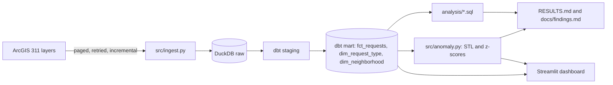

# Miami-Dade 311 service analytics

## Problem

Miami-Dade County publishes every 311 service request, but as separate yearly layers with two incompatible schemas. This project turns them into one tested dataset and answers practical questions: where do residents wait longest, what is stuck in the backlog, where do problems recur, and which weeks were truly unusual?

Plain-language findings are in [docs/findings.md](docs/findings.md).

## Architecture



## How to run

You need [uv](https://docs.astral.sh/uv/) and `make`.

```bash
make all
```

This installs everything, downloads the live data (over an hour the first time), builds and tests the models, and writes the results. Later runs fetch only what changed.

To try the whole pipeline offline in about a minute, on generated rows:

```bash
make sample
```

Other commands:

```bash
make dashboard
```

```bash
make screenshots
```

```bash
make test
```

```bash
scripts/check.sh
```

## Results

<!-- results:start -->
<!-- results:end -->

### Dashboard


## Known limits

- **System change on 2024-08-11.** The two systems share no type taxonomy. The crosswalk in `dbt/seeds/request_type_crosswalk.csv` is hand-written and covers only labels with a clear equivalent, and county scope also changed, so levels across that date are approximate. Anomaly flags within two weeks of it are dropped.
- **Backlog is new-system only.** Old-system layers stopped receiving status updates, so their open rows are excluded.
- **Time to close covers closed requests only,** which understates waits, most of all for recent requests.
- **ZIP code stands in for neighborhood,** because the source has no neighborhood field.
- **Source lag.** The county refreshes these layers about monthly, so a weekly run can find nothing new.
- **Event matching is a coincidence check, not proof of cause.** The event list stops at what was known when it was written, and storm windows are wide. Compare the match rate with the chance baseline in `RESULTS.md`.
- **`scripts/check.sh` runs on generated rows,** so it proves the code works, not that live numbers are current.

## Trade-offs

- **DuckDB over a warehouse:** one file and no server or account, but one writer at a time.
- **Raw JSON rows over typed raw columns:** both schemas load unchanged and dbt handles the differences, at some cost in storage.
- **Created-or-modified incremental filter over created date alone:** otherwise a closure on an older request would never arrive.
- **STL with outlier masking over robust STL:** robust mode absorbed the largest spikes into the seasonal term. Masking adds a refit loop.
- **Noise from week-to-week changes over residual spread:** with few yearly cycles, STL fits ordinary weeks too closely for residual spread to be a fair scale.
