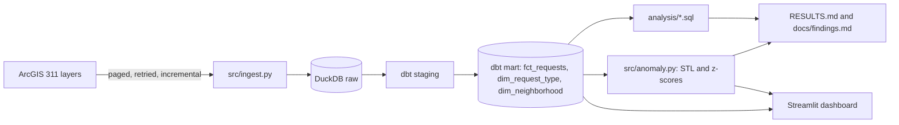

# Miami-Dade 311 service analytics

I turned Miami-Dade County's public 311 records into a tested pipeline, SQL analysis, anomaly detection and a dashboard.

[](https://github.com/abhiramvedipala/miami-311-analytics/actions/workflows/ci.yml)

## Problem

Miami-Dade publishes every 311 service request, but as separate yearly layers with two incompatible schemas. That makes simple questions hard for county managers, journalists and residents: where do people wait longest, what is stuck in the backlog, where do problems keep coming back, and which weeks were truly unusual? This project answers them from one tested dataset.

Plain-language findings are in [docs/findings.md](docs/findings.md).

## Demo


## Architecture



The loader pages through the county's layers and upserts rows into a raw DuckDB table as JSON. dbt maps the two source schemas to shared columns in staging, then builds a fact table and two dimensions, with tests that fail the build on bad data. SQL files answer the analysis questions, and the anomaly script scores weekly volumes. Scripts write every reported number to `RESULTS.md`, and the dashboard reads the same mart and the same SQL files.

## Tech stack

| Tool | What it's used for | Why I chose it |
|---|---|---|
| Python | Ingestion, anomaly detection, reports | Simple to read, with the libraries this work needs |
| DuckDB | Storage and queries | One file, no server, fast at this size |
| dbt-duckdb | Staging, marts and data tests | Versioned SQL with tests that fail loudly |
| statsmodels | STL decomposition | An explainable expected-versus-actual baseline |
| Streamlit and Altair | Dashboard | Free, and runs from the repo with one command |
| Playwright | Dashboard screenshots | Repeatable images from a headless browser |
| pytest | Tests | Plain and familiar |
| GitHub Actions | CI and the weekly refresh | Lives with the code and needs no extra account |
| uv and Make | Install and run commands | Provides Python 3.12 and gives one command to run |

## Quick start

You need [uv](https://docs.astral.sh/uv/) and `make`.

```bash
make all
```

This installs everything, downloads the live data (over an hour the first time), builds and tests the models, and writes the results. Later runs fetch only what changed.

To try the whole pipeline offline on generated rows, in about a minute:

```bash
make sample
```

To open the dashboard after `make all`:

```bash
make dashboard
```

## Results

Each number below comes from a script. `RESULTS.md` names the command for each section, and `make all` reruns them all.

<!-- results:start -->
<!-- results:end -->
