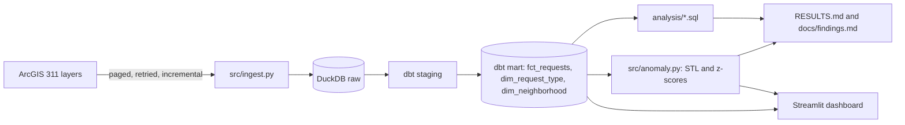

# Miami-Dade 311 service analytics

I turned Miami-Dade County's public 311 records into a tested pipeline, SQL analysis, anomaly detection and a dashboard.

[](https://github.com/abhiramvedipala/miami-311-analytics/actions/workflows/ci.yml)

## Problem

Miami-Dade publishes every 311 service request, but as separate yearly layers with two incompatible schemas. That makes simple questions hard for county managers, journalists and residents: where do people wait longest, what is stuck in the backlog, where do problems keep coming back, and which weeks were truly unusual? This project answers them from one tested dataset.

Plain-language findings are in [docs/findings.md](docs/findings.md).

## Demo


## Architecture



The loader pages through the county's layers and upserts rows into a raw DuckDB table as JSON. dbt maps the two source schemas to shared columns in staging, then builds a fact table and two dimensions, with tests that fail the build on bad data. SQL files answer the analysis questions, and the anomaly script scores weekly volumes. Scripts write every reported number to `RESULTS.md`, and the dashboard reads the same mart and the same SQL files.

## Tech stack

| Tool | What it's used for | Why I chose it |
|---|---|---|
| Python | Ingestion, anomaly detection, reports | Simple to read, with the libraries this work needs |
| DuckDB | Storage and queries | One file, no server, fast at this size |
| dbt-duckdb | Staging, marts and data tests | Versioned SQL with tests that fail loudly |
| statsmodels | STL decomposition | An explainable expected-versus-actual baseline |
| Streamlit and Altair | Dashboard | Free, and runs from the repo with one command |
| Playwright | Dashboard screenshots | Repeatable images from a headless browser |
| pytest | Tests | Plain and familiar |
| GitHub Actions | CI and the weekly refresh | Lives with the code and needs no extra account |
| uv and Make | Install and run commands | Provides Python 3.12 and gives one command to run |

## Quick start

You need [uv](https://docs.astral.sh/uv/) and `make`.

```bash
make all
```

This installs everything, downloads the live data (over an hour the first time), builds and tests the models, and writes the results. Later runs fetch only what changed.

To try the whole pipeline offline on generated rows, in about a minute:

```bash
make sample
```

To open the dashboard after `make all`:

```bash
make dashboard
```

## Results

Each number below comes from a script. `RESULTS.md` names the command for each section, and `make all` reruns them all.

<!-- results:start -->
<!-- results:end -->

## How it works

**Two systems, one dataset.** The county changed 311 systems on 2024-08-11, renaming every field and changing status codes and request labels. `stg_requests.sql` maps both to shared columns, and a hand-written crosswalk joins only the request types with a clear equivalent.

**Incremental loads that see closures.** I filter on created or modified date, because a created-date filter would never notice an old request being closed. Rows upsert by request id, and each layer's watermark is saved only when that layer finishes.

**Anomaly detection that keeps big spikes.** Robust STL absorbed the largest spikes into its seasonal term. So I mask outliers with a rolling median, refit, and score the original series against the clean fit. Noise comes from week-to-week changes, because residuals are too small to be a fair scale with few yearly cycles.

**Honest event matching.** Flags are checked against storms and federal holidays, and results include the share of all weeks that would match by chance. A simulation with planted spikes separately measures recall and false flags.

**Numbers that can't be hand-edited unnoticed.** Each `RESULTS.md` section stores a hash of its body and its data source. `scripts/check.sh` fails on an edited number or on figures from the sample data.

## Testing

```bash
make test
```

The 25 tests cover retries and paging, upserts, percentile and bucket logic on rows with known answers, spike detection and event matching, the results hash, findings generation, and rendering the dashboard. dbt adds data tests on every build.

`scripts/check.sh` is the full check. It installs from clean, runs the tests, runs the pipeline on sample data, starts and stops the dashboard, verifies `RESULTS.md`, and requires a clean, pushed tree.

## Design decisions and trade-offs

All of them are in [DECISIONS.md](DECISIONS.md). The top three:

- **I chose DuckDB over a warehouse.** It is one file with no server or account. The trade-off is one writer at a time.
- **I store raw rows as JSON.** Both schemas load unchanged and dbt handles the differences, at some cost in storage.
- **I use STL with outlier masking rather than robust STL.** It keeps the largest spikes, at the cost of a refit loop.

## Known limits and next steps

- **System change on 2024-08-11.** The crosswalk covers only clear equivalents and county scope also changed, so levels across that date are approximate. Anomaly flags within two weeks of it are dropped.
- **Backlog is new-system only.** Old-system layers stopped receiving status updates, so their open rows are excluded.
- **Time to close covers closed requests only,** which understates waits, most of all for recent requests.
- **ZIP code stands in for neighborhood,** because the source has no neighborhood field.
- **Source lag.** The county refreshes these layers about monthly, so a weekly run can find nothing new.
- **Event matching is a coincidence check, not proof of cause,** and the event list stops at what was known when I wrote it.
- **`scripts/check.sh` runs on generated rows,** so it proves the code works, not that live numbers are current.

Next, I would add a survival model for time to close, score new weeks against a baseline fitted only on past data, and deploy the dashboard.

## Project structure

```text
.
├── src/                 ingestion, reports, anomaly detection, sample data
├── dbt/                 staging and mart models, seeds, data tests
├── analysis/            one SQL file per question
├── dashboard/           Streamlit app
├── scripts/             check.sh and dashboard screenshots
├── tests/               pytest suite
├── docs/                findings, interview notes, screenshots
├── .github/workflows/   CI and weekly refresh
├── RESULTS.md           every reported number, written by scripts
└── DECISIONS.md         one line per design decision
```
