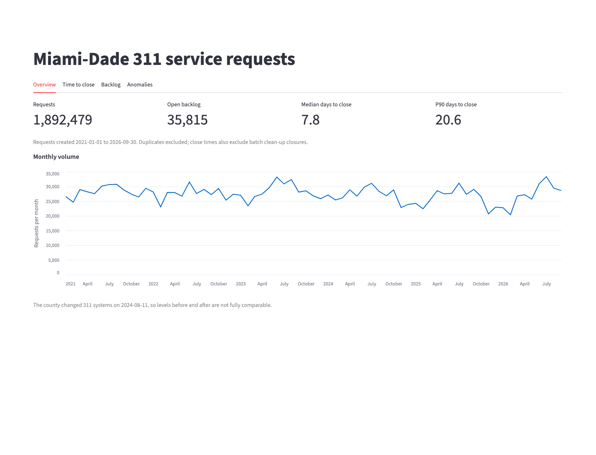
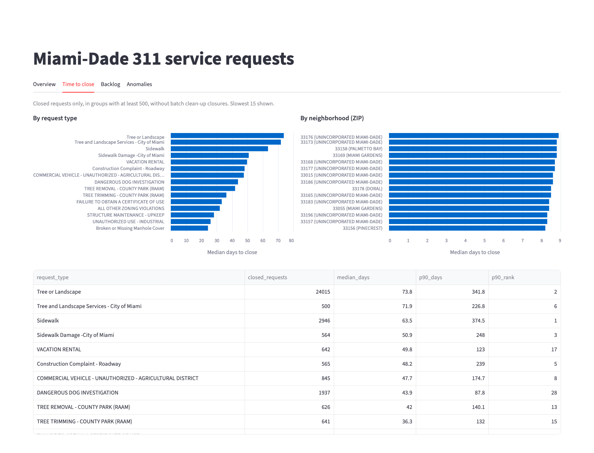
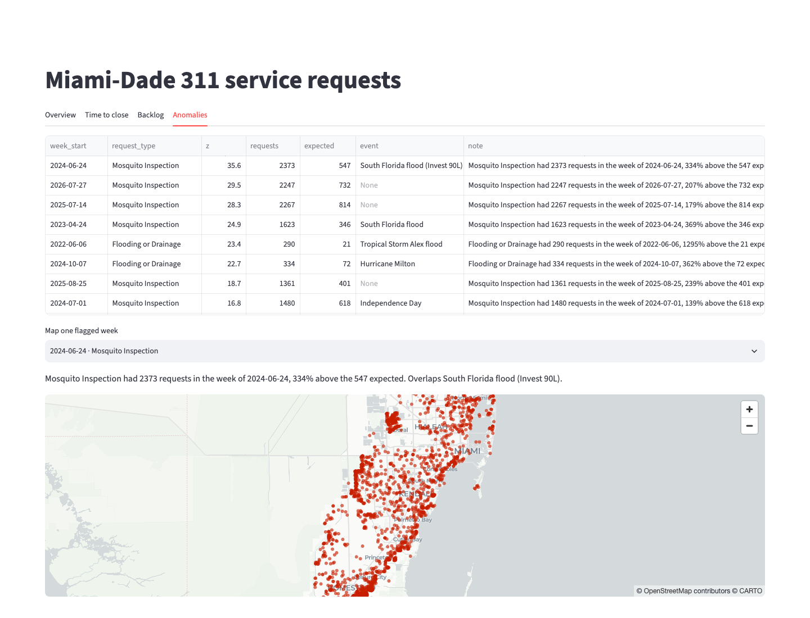
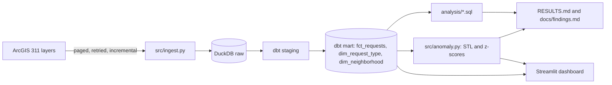

# Miami-Dade 311 service analytics

I turned Miami-Dade County's public 311 records into a tested pipeline, SQL analysis, anomaly detection and a dashboard.

## Problem

Miami-Dade publishes every 311 service request, but as separate yearly layers with two incompatible schemas. That makes simple questions hard for county managers, journalists and residents: where do people wait longest, what is stuck in the backlog, where do problems keep coming back, and which weeks were truly unusual? This project answers them from one tested dataset.

Plain-language findings are in [docs/findings.md](docs/findings.md).

## Demo

## Architecture

The loader pages through the county's layers and upserts rows into a raw DuckDB table as JSON. dbt maps the two source schemas to shared columns in staging, then builds a fact table and two dimensions, with tests that fail the build on bad data. SQL files answer the analysis questions, and the anomaly script scores weekly volumes. Scripts write every reported number to `RESULTS.md`, and the dashboard reads the same mart and the same SQL files.
